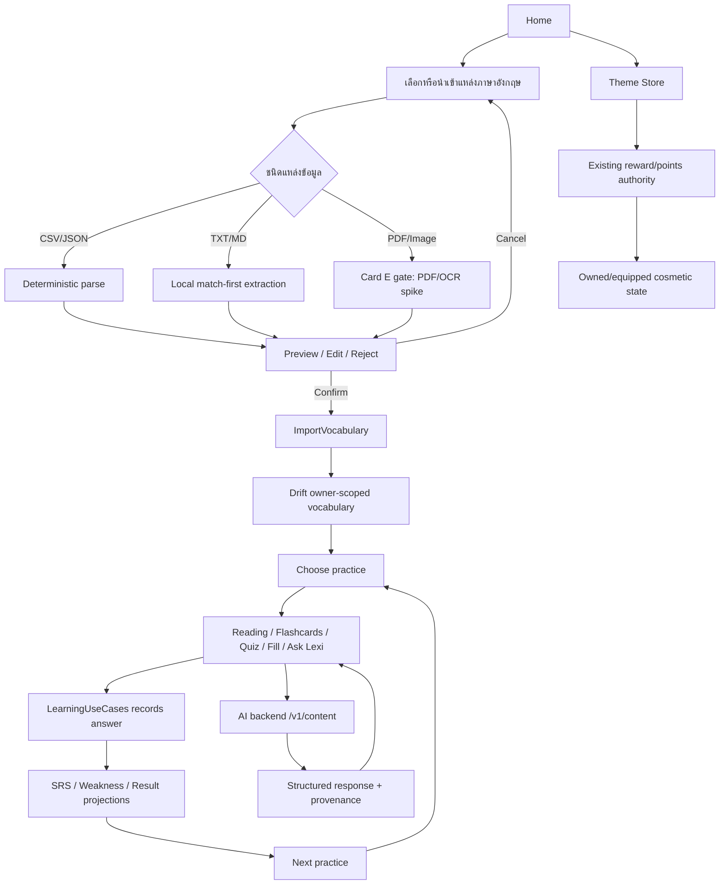

# LexiQuest · Astra Integration · Evidence-Derived Claude Blue Team Plan

วันที่: 2026-10-20
สถานะ: `EVIDENCE-DERIVED BLUE TEAM PLAN` — แผนสังเคราะห์จากผล Claude ที่บันทึกไว้ใน repository ไม่ใช่ผลที่สร้างขึ้นใหม่จาก Claude ในรอบนี้
ขอบเขต: การปรับดีไซน์ โฟลว์ระบบ และแผนพัฒนา Android-first สำหรับการฝึกภาษาอังกฤษเท่านั้น

## 0. Provenance และสถานะ provider

การเรียก provider รอบนี้ไม่สำเร็จ จึงไม่อ้างว่าเอกสารนี้เป็น fresh Claude generation:

| รายการ | ค่า |
| --- | --- |
| Requested model | `claude-opus-5-5` |
| Endpoints ที่ลอง | `messages`, `chat/completions` |
| ผล | HTTP `524` ทั้งสอง endpoint หลังลด prompt และ output budget แล้ว |
| Token usage | unavailable — provider ไม่คืน response body/usage |
| Recovery disposition | หยุด provider path ตาม retry budget และใช้ safe alternative จากหลักฐาน Claude ที่มีอยู่จริง |

หลักฐานที่ใช้เท่านั้น:

1. `docs/design/claude-design-review-2026-10-18.md` — spacing ของฟอร์ม, keyboard/short-height scroll, consent Back semantics, TalkBack/focus/font-scale gaps
2. `docs/design/claude-r7-final-verdict.md` — ผลตรวจปลายทางของ marketplace เรื่อง routing, hierarchy, state, localization, accessibility
3. `docs/design/claude-r7-rendered-critique.md` — arithmetic, Thai line height, preview contrast, owned-grid density, Back preservation และ offline-owned state
4. `docs/design/claude-r7-theme-marketplace-direction.md` — art direction, route graph, state model, 8dp rhythm, 20dp gutters, 48dp targets และ redeem/apply flow
5. `docs/research/2026-10-20-astra-ai-social-feature-analysis.md` — Claude Opus 5.5 disposition `REVISE`, เงื่อนไข Card A–E และข้อสรุป `GO for Card A planning`

## 1. Executive decision

**คำตัดสิน: `GO for Card A planning`; `REVISE` ก่อนเปิด Card B–E และก่อนอ้างว่า implementation พร้อมใช้งาน**

Design thesis คือ **“แหล่งเรียนหนึ่งชุด พาไปฝึกต่อได้ทันที และทุกผลกลับเข้าสู่หลักฐานเดิม”**:

1. ผู้ใช้เลือกหรือนำเข้าเนื้อหาภาษาอังกฤษ
2. ระบบแสดงสิ่งที่อ่านได้และให้แก้ก่อนยืนยัน
3. เนื้อหาเดียวพาไปอ่าน บัตรคำ แบบทดสอบ เติมคำ หรือถาม Lexi
4. คำใบ้ไม่เพิ่ม mastery; การเปิดเฉลยบันทึกผิดหนึ่งครั้งผ่าน authority เดิม
5. ผลจริงไหลเข้า `LearningUseCases`, SRS, Weakness และ Result เดิม
6. ร้านธีมเป็นรางวัลเชิงตกแต่ง ไม่เปลี่ยนผลการเรียน

โครงหน้าใช้ AllTCAS เป็นฐาน hierarchy, Duolingo เป็นจังหวะเรียนต่อ/ซ่อมจุดอ่อน/รางวัล และ Astra เป็นลำดับ source-first/Socratic/provenance โดยไม่คัดลอกแบรนด์ asset สี copy หรือหน้าจอแบบ pixel-for-pixel

## 2. แผนตามบทบาท SE

| บทบาท | การตัดสินใจ | Deliverables | Dependencies | Acceptance |
| --- | --- | --- | --- | --- |
| PM | ส่งมอบเป็นลำดับ A→B→C→D→E; ห้ามเปิด PDF/OCR ก่อน A–D ผ่าน | roadmap, card status, gate/rollback, evidence links | active plan, feature registry 8/44 | ทุก card มี owner, scope, write set, acceptance และ evidence; ไม่มี `f45` |
| SA | คง authority เดิมและแยก deterministic local path จาก AI path | context/state diagram, contract boundaries, failure modes | `ImportVocabulary`, `LearningUseCases`, `/v1/content`, entitlement | ไม่มี persistence/SRS/mastery/reward authority ชุดที่สอง; offline learning ยังทำงาน |
| BA | เปลี่ยนความต้องการ Astra เป็น workflow ภาษาอังกฤษและคำไทยทั่วไป | user journeys, state/copy matrix, traceability ไป 8/44 | research evidence, existing catalog | ทุกขั้นมี next action ชัด; ไม่มีวิชาอื่น โรงเรียน หรือ claim คะแนนคาดการณ์ |
| UX/UI | ใช้ hierarchy ที่คุ้นเคย, primary CTA เดียว, Thai readability และ responsive rules | screen/state spec, component/state inventory, prototype route map | R8, Claude reviews, Material/theme เดิม | 48dp targets, 8dp target gap, Thai line height, contrast, Back/focus/keyboard/font scale ผ่าน |
| Dev | reuse dependency/service/screen เดิมและเพิ่มโค้ดเท่าที่ card ต้องใช้ | focused diff, tests, migration/schema impact statement | file discovery, current dirty branch, stable contracts | cancel ไม่เขียน, retry ไม่ซ้ำ, restart เห็นข้อมูล, answer/reward idempotent |
| QA | ทดสอบ semantics ไม่ใช่เพียงภาพสวย | test matrix, defect disposition, emulator/device evidence | consistent source snapshot, fixtures, gates | unit/widget/golden/integration/backend/Android/accessibility/offline/slow-network ครบตาม card |

## 3. การเปลี่ยนดีไซน์ราย surface

กฎร่วม: compact canonical `393×876dp`; gutter โทรศัพท์ 20dp ตามทิศทาง Claude marketplace; spacing ใช้ 8dp rhythm; control อย่างน้อย 48dp; เนื้อหาหลักมี primary CTA เดียว; ข้อความไทยใช้คำทั่วไปและระยะบรรทัดไม่ต่ำกว่า baseline ที่ตรวจไว้สำหรับเนื้อหาไทยหลายบรรทัด

| Surface | Hierarchy และ primary CTA | States ที่ต้องมี | Responsive behavior |
| --- | --- | --- | --- |
| Login / Onboarding | โลโก้/คุณค่า → ฟอร์ม → CTA เข้าสู่ระบบ → Google action → ข้อมูลเสริม; onboarding หนึ่งคำถามต่อหน้า | default, validation, loading, auth error, keyboard-open, short-height | ฟอร์ม scroll ได้; ระยะหัวข้อถึง field 20dp; CTA และ Google มาก่อน info card; medium/expanded จำกัด form ≤560dp |
| Home | greeting/status สั้น → แผนวันนี้ → เรียนต่อ → path preview → quick actions | loading, no-due, due, weakness, offline, stale | compact single column; medium ใช้ centered content; expanded เพิ่ม supporting pane โดยไม่แย่ง CTA หลัก |
| Source Import | source picker → file summary/excerpt → parsed candidates → edit/reject → confirm | unsupported type, oversize, parse error, empty, duplicate, accepted/rejected, cancel, offline | compact ใช้ step pages; medium/expanded ใช้ source list + preview เมื่อ pane กว้างพอ; primary content ≤720dp |
| Catalog / Setup | เลือกชุด → รายละเอียด → ตั้งค่ารอบ → เริ่มฝึก | loading, empty, unavailable, selected, validation | compact stepper; expanded list-detail; รักษา selection เมื่อ resize/rotate |
| Quiz / Feedback | progress → prompt → choices/input → บันทึก → feedback ในบริบทเดิม → ข้อต่อไป | unanswered, selected, saving, correct, wrong, reveal, save error/retry | compact single task; จอสั้นให้ feedback เลื่อนหรือ bottom sheet; expanded ไม่กระจาย prompt กับ CTA ไกลกัน |
| Result / Weakness | evidence รอบนี้ → คำที่พลาด → next action | perfect, mistakes, empty evidence, stale/offline | primary CTA คือฝึกคำที่พลาด หรือกลับแผนวันนี้; expanded ใช้ summary + mistake list |
| Library / Flashcards | due summary → filter/search → deck/category → card practice | empty, due, owned data offline, sync error | compact list/card; medium/expanded list-detail; selection และ scroll ต้องคงอยู่ |
| AI Tutor | source/context card → bubble แบบ LINE/Messenger → structured hint/example → provenance → practice action → composer | idle, sending, one in-flight, answer, quota, timeout, offline match-only, retry/edit | compact composer ติดล่างและไม่ชน IME; medium/expanded จำกัด AI ≤760dp และใช้ supporting source paneได้ |
| Progress | ฉันอยู่ตรงไหน → อะไรดีขึ้น → ทำอะไรต่อ → tabs ภาพรวม/จุดอ่อน/ความสำเร็จ | insufficient evidence, normal, stale, offline | compact stacked; expanded summary + detail; ห้ามใช้แต้มแทน mastery |
| Theme Store | balance card → categories → grid → detail → preview → confirm → success/apply | unowned, owned, equipped, insufficient points, stale, offline-owned, expired | compact 2-column เมื่อข้อความไม่ล้น; expanded เพิ่มคอลัมน์ตาม min card width; preserve tab/scroll/back context |
| Settings / Account | account → learning preferences → appearance/theme → accessibility → privacy/data | loading, unavailable, offline-safe, destructive confirmation | compact grouped list; expanded max form width; consent modal Back/dismiss เท่ากับ “ไม่เข้าร่วม” ตามหลักฐาน Claude |

### Marketplace constraints จากหลักฐาน Claude

- ใช้ market coral เฉพาะบริบท marketplace, amber สำหรับแต้ม และ success green สำหรับ owned/equipped โดยต้องผ่าน contrast จริง
- preview ต้องมี scrim หรือ surface คงที่ให้ label ≥4.5:1
- confirmation ต้องคำนวณก่อน/หลังจาก item/price ของ entry path จริง ไม่ hardcode รายการเดียว
- owned item ห้ามถูกหักแต้มซ้ำ; offline-owned ต้อง preview cached item ได้ ขณะที่ browse/redeem ที่ต้องออนไลน์ถูกปิดพร้อมข้อความชัด
- Shop → Detail → Back ต้องคืน tab และ scroll; Preview → Back ปิด sheet; History → Back คืน points center
- motion/confetti เป็น refinement หลัง P0/P1 ผ่านและต้องรองรับ Reduce Motion

## 4. End-to-end flow และ authority boundaries

Authority rules:

- `ImportVocabulary` เป็น write boundary ของการนำเข้าคำ; preview/parser ห้ามเขียนฐานข้อมูลเอง
- `LearningUseCases` เป็น write boundary ของ answer evidence; AI และ UI ห้ามเขียน mastery/reward โดยตรง
- `reveal` บันทึก wrong หนึ่งครั้งด้วย assisted/reveal `promptMode`; hint อย่างเดียวไม่เขียน mastery/reward
- `/v1/content` ใช้ auth, request limits, timeout, provider chain, cache และ rate limit เดิม; client มี in-flight request เดียว
- deterministic import/local match ใช้งานได้เมื่อ AI, quota หรือ network ไม่พร้อม; unknown candidate อยู่ใน preview และไม่ auto-import
- Theme Store ใช้ points/reward authority เดิมและต้อง idempotent; cosmetic state ไม่ปลดล็อกความสามารถการเรียน
- งานนี้ไม่เปลี่ยน consent, research enrollment/upload, deployment หรือ EvidenceContext/EventEnvelopeV2

## 5. ADLC delivery plan

### Phase 0 — Intent / Ground

ผลลัพธ์: inventory จริงของ route, feature ID, caller, state authority และ active Figma/prototype baseline

- discover-before-edit ด้วย `rg --files` และ `rg` สำหรับ caller ของ import, tutor, theme, navigation และ settings
- ยืนยัน mapping ทั้งหมดเข้า 8/44 และ feature flag/entitlement ที่มีอยู่
- บันทึก source snapshot เพราะ branch มีงานเดิมที่แก้ค้าง

Exit gate: write set ไม่ทับงานเดิม, acceptance ของ Card A ชัด, ไม่มี schema/dependency ใหม่โดยไม่จำเป็น

### Phase 1 — Plan / Execute: Card A CSV/JSON import

ใช้ `file_selector` และ `ImportVocabulary` เดิม เพิ่มเฉพาะ picker → deterministic parser → preview/edit/cancel → confirm

File impact ที่ยืนยันชื่อได้:

- `lib/screens/vocab_list_screen.dart`
- `lib/screens/add_multiple_words_screen.dart`
- `lib/features/vocabulary/application/import_vocabulary.dart` เฉพาะเมื่อ contract ปัจจุบันไม่พอ
- `lib/runtime/app_bootstrap.dart` และ `lib/runtime/app_dependencies.dart` เฉพาะ wiring ที่จำเป็น
- tests ใกล้เคียงใน `test/features/vocabulary/`, `test/screens/` และ offline journey

ห้ามต่อ persistence ผ่าน `lib/screens/wordbook_import_screen.dart` หรือ `lib/services/custom_wordbook_importer.dart`

Exit gate: owner isolation, size/type validation, cancel no-write, retry no duplicate, restart sees import, accepted/duplicate/rejected ถูกต้อง

### Phase 2 — Review / Attest: Design foundation และ core surfaces

ปรับ theme/navigation และ component ที่ใช้ซ้ำจริงอย่างน้อยสองหน้า แล้ว polish Quiz/Feedback/Result/Weakness โดยไม่เปลี่ยน scheduling semantics

File impact ที่ยืนยันจาก active plan:

- `lib/config/m3_theme.dart`
- `lib/screens/main_navigation_screen.dart`
- `lib/screens/quiz_screen.dart`
- `lib/screens/weakness_clinic_screen.dart`
- `lib/screens/score_screen.dart`
- `lib/screens/srs_flashcards_screen.dart`
- widget/layout/golden tests ที่เกี่ยวข้อง

Exit gate: compact/dark/font scale ไม่มี overflow; route/back เดิมยังถูกต้อง; save/retry/reveal idempotent; color มี text/semantics

### Phase 3 — Integrate: Card B + C

- Card B รับ TXT/MD, local match-first, preview source/candidates/provenance และ unknown no-auto-import
- Card C เปิด reading/flashcards/quiz/fill/Ask Lexi จาก source เดียว โดย answer ผ่าน `LearningUseCases`
- ตำแหน่งไฟล์ใหม่หรือ parser ให้ discover existing source/import abstractions ก่อนตั้งชื่อ

Exit gate: offline local path ผ่าน, raw source ไม่อยู่ใน log/implicit queue, feedback/SRS/weakness/result ใช้ authority เดิม

### Phase 4 — Integrate: Card D Socratic AI

ปรับ `lib/screens/ai_tutor_screen.dart` และ backend contract เฉพาะ field ที่จำเป็นสำหรับ `ช่วยฉันคิดทีละขั้น` / `อธิบายให้เลย`, source provenance และ practice actions

Backend impact ต้อง discover caller/tests รอบ `backend/ai_api/src/lexiquest_ai/` ก่อนแก้; reuse request validation, auth, provider chain, cache และ rate limit

Exit gate: timeout/quota/offline/edit/retry ชัด, one in-flight, retry failure ไม่หัก quota, AI ไม่เขียน learning/reward authority

### Phase 5 — Learn / Gate: Card E PDF/OCR

ทำ dependency/APK-size/runtime spike ก่อนเลือก `pdfrx` หรือ ML Kit; ยังไม่เพิ่ม dependency ใน plan นี้

Exit gate: malformed/encrypted/oversize/timeout/cancel/rotation/low-light ผ่าน; OCR ทุกครั้ง preview/edit/retake/delete/confirm; no raw logging

## 6. Acceptance criteria และ test matrix

| ชั้นทดสอบ | หลักฐานขั้นต่ำ |
| --- | --- |
| Unit | parser valid/invalid/oversize/duplicate; reveal once; hint no-write; price arithmetic; owned no-charge |
| Widget | import preview/edit/cancel/confirm; keyboard-open login; quiz save/retry; AI sending/quota/offline; marketplace owned/offline/stale |
| Golden/layout | 360×800, 393×876, 412×915, 600×960, 800×1280, 1024×1366, 1280×800; light/dark; text scale 100/130/200% |
| Integration | Home→Import→Confirm→Practice→Feedback→Result→Weakness; Home→AI→Provenance→Practice; Shop→Preview→Redeem→Apply→Back |
| Backend contract | auth, length, timeout, structured response, provider failure, cache/rate-limit, no raw source logs |
| Data | owner isolation, restart durability, duplicate retry, lost acknowledgement, export/deletion/sync impact หากมี entity ใหม่ |
| Accessibility | TalkBack label/focus/announcement timing, 48dp targets, contrast, Thai line height, Reduce Motion, IME/insets |
| Network | deterministic import offline; AI match-only fallback; slow/timeout retry; offline-owned preview; no hidden raw queue |
| Android | build/install, system/predictive Back, edge-to-edge, keyboard inset, process restart, rotation |
| Responsive/foldable | LDPlayer ใช้ตรวจ resolution/DPI/orientation เท่านั้น; hinge/posture/occlusion ต้องใช้ emulator API หรืออุปกรณ์จริงก่อนอ้างว่าผ่าน |

เกณฑ์รวม:

- ไม่มี dead interaction, accidental self-loop, broken destination หรือ state สำคัญหายเมื่อ Back/resize/rotate
- ไม่มี overflow/truncation ที่ fixtures ข้างต้น
- Thai body หลายบรรทัดมี line height อย่างน้อย 1.5× ตาม critique และ metadata ไม่ลดต่ำจนเป็นข้อความตัดสินใจที่อ่านยาก
- preview label contrast ≥4.5:1 บนทุกภาพหรือมี scrim/surface คงที่
- ทุก completion claim ระบุ source snapshot และ checks ที่รันจริง

## 7. Risk register, rollback และ feature gates

| Risk | Mitigation | Rollback / Gate |
| --- | --- | --- |
| สร้าง import authority ซ้ำ | route ทุก confirm ผ่าน `ImportVocabulary` | ปิด entry ใหม่; คง AddMultipleWords เดิม |
| AI สร้างเนื้อหาผิดหรือไม่มีที่มา | provenance + verify/practice actions + local fallback | ปิด Socratic flag; local learning ยังทำงาน |
| answer/reward ซ้ำจาก retry | idempotent boundary และ focused lost-ack tests | disable new prompt mode; ไม่แก้ ledger ย้อนหลังอัตโนมัติ |
| raw source รั่วใน log/queue | size/type validation, no raw logging, no implicit queue | ปิด file type/AI transform ที่ได้รับผลกระทบ |
| UI สวยแต่ภาษาไทยอ่านยาก | line-height, left-aligned prose, text-scale/golden/TalkBack | rollback token/component change ไม่ rollback data |
| marketplace หักแต้มผิด | dynamic price/balance, owned idempotency | ปิด redeem; owned/apply offline ยังคงได้หาก cached |
| responsive/foldable claim เกินหลักฐาน | แยก emulator/LDPlayer/device evidence | ไม่ประกาศ foldable support จน runtime ผ่าน |
| dependency ทำ APK โต | Card E spike และ budget ก่อนเพิ่ม | defer PDF/OCR; TXT/MD/CSV/JSON ยังใช้ได้ |

Feature gates ต้องใช้ registry/entitlement ที่มีอยู่หลัง discover mapping; ห้ามสร้าง feature `f45` หรือ parallel flag authority

## 8. Reuse / Build / Defer / Reject

| การตัดสิน | รายการ |
| --- | --- |
| Reuse | `file_selector`, camera gateway/preprocessing, `ImportVocabulary`, Drift owner isolation/dedup, `LearningUseCases`, `BinarySm2SrsPolicy`, Weakness/SRS/Result, `/v1/content`, auth/cache/rate limit, AiTutor/STT/TTS, Material/theme และ reward authority เดิม |
| Build | import preview/editor, deterministic file adapter, TXT/MD source view, source-to-practice actions, Socratic mode controls/provenance UI, missing state/error/accessibility tests |
| Defer | PDF/OCR dependency, 3D, podcast generation, printed exam, phone-to-desktop handoff, optional delight motion จน P0/P1 ผ่าน |
| Reject | multi-subject/school/national exam catalog, uncalibrated readiness/predicted score, wholesale AI tutor repo, parallel SRS/mastery/reward, pixel-copy ของ Astra/AllTCAS/Duolingo, `f45` |

## 9. Entry gates, exit gates และห้างานแรก

Entry gate สำหรับ implementation:

- Card A scope/write set/callers/test fixtures ยืนยันจาก source ปัจจุบัน
- mapping เข้า 8/44 และ entitlement เดิมชัด
- pre-existing dirty work แยกจาก write set
- design states สำหรับ import/error/offline ผ่าน review

Exit gate สำหรับแต่ละ Card:

- focused checks ผ่านบน source snapshot เดียวกัน
- review disposition ปิด P0/P1 หรือบันทึกเหตุผลที่ยังเปิด
- accessibility/offline/data-boundary acceptance ของ card ผ่าน
- ไม่มี claim hardware/release/research ที่หลักฐานยังไม่รองรับ

ลำดับห้างานแรก:

1. ทำ Ground inventory ของ caller/route/feature mapping สำหรับ import และ active navigation
2. เขียน Card A acceptance fixtures ก่อน implementation: valid, invalid, oversize, duplicate, cancel, retry, restart, owner isolation
3. ทำ import UI จาก `VocabListScreen`/`AddMultipleWordsScreen` ผ่าน `file_selector` และ confirm เข้า `ImportVocabulary`
4. ตรวจและปรับ shared design foundation เฉพาะ token/component ที่ Card A และ core learning ใช้จริง
5. รัน focused test + responsive/accessibility review แล้วออก disposition ก่อนเริ่ม Card B

## 10. Assumptions และ evidence gaps

- R8 routing/validator/prototype evidence เป็นหลักฐานของต้นแบบ ไม่ใช่ Flutter runtime หรืออุปกรณ์จริง
- ผล Claude marketplace `PASS` ใช้กับ prototype revision ที่ตรวจในวันนั้น ไม่รับรองโค้ด implementation ปัจจุบัน
- ยังไม่มี fresh Claude Blue Team generation รอบนี้เพราะ provider คืน HTTP 524; เนื้อหานี้จึงเป็นการสังเคราะห์อย่างมี traceability จากไฟล์ Claude เดิมเท่านั้น
- ยังต้อง discover exact feature IDs, entitlements, route callers และ schema ledger ก่อนแก้ code; เอกสารนี้ไม่เดาชื่อสิ่งที่ยังไม่ยืนยัน
- ยังไม่มีหลักฐาน efficacy, readiness calibration, physical foldable, OCR accuracy หรือ APK-size budget
- การติดตั้ง/ใช้งานจริง การ deploy การเปิด research enrollment/upload และการเปลี่ยน consent อยู่นอกขอบเขต

## 11. Traceability summary

| ข้อสรุปในแผน | หลักฐานต้นทาง |
| --- | --- |
| Login spacing/scroll/consent Back/TalkBack/font scale | `claude-design-review-2026-10-18.md` |
| Marketplace route/state/Thai readability/offline-owned/arithmetic/contrast | `claude-r7-rendered-critique.md`, `claude-r7-final-verdict.md` |
| Marketplace visual hierarchy, route graph, spacing, targets, redeem/apply | `claude-r7-theme-marketplace-direction.md` |
| A→B→C→D→E, local fallback, reveal/hint semantics, AI limits, OCR preview, offline fixtures | `2026-10-20-astra-ai-social-feature-analysis.md` |
| Provider failure disclosure | การเรียก `claude-opus-5-5` รอบ 2026-10-20: HTTP 524, usage unavailable |

เอกสารนี้อนุมัติ **Card A planning** เท่านั้น การเลื่อน Card B–E เป็น `Ready` ต้องผ่าน predecessor และ focused acceptance ของแต่ละ Card
