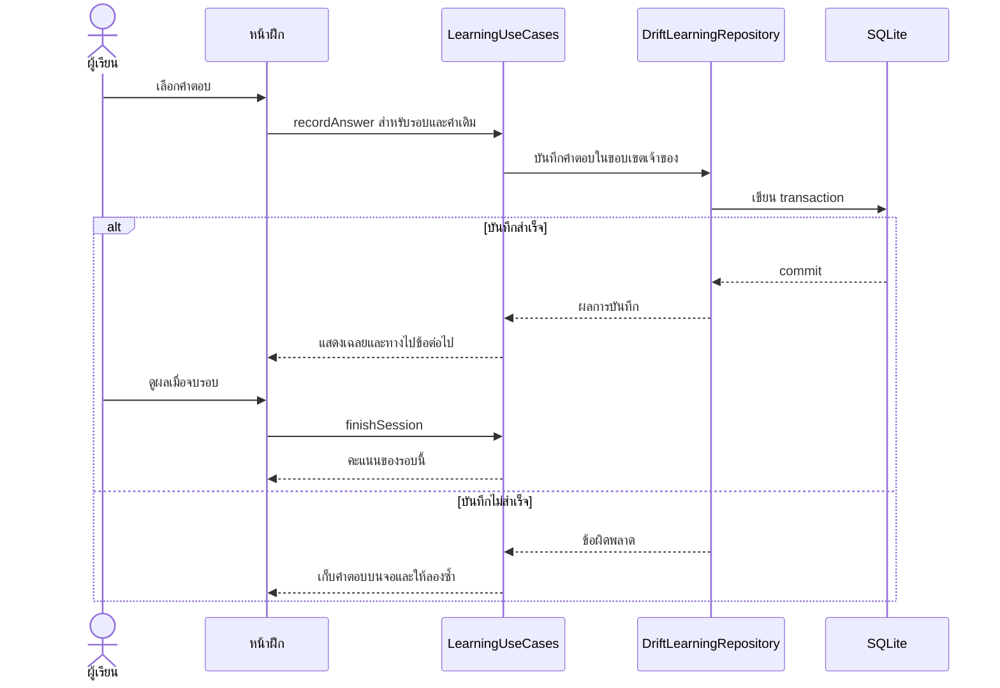
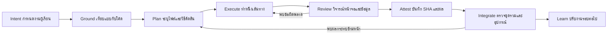

# LexiQuest จาก FigCraft สู่ Flutter รุ่นต้นแบบบน Android

**เป้าหมายรุ่นแรก** ผู้เรียนภาษาไทยเปิดแอปแล้วรู้ว่าจะฝึกอะไร หาคำที่เคยเก็บไว้ได้ เพิ่มคำเองหรือใช้กล้อง นำคำไปฝึก ดูผลและกลับมาฝึกต่อได้แม้ปิดแอป การส่งมอบเป็น APK ต้นแบบสำหรับทดสอบ ส่วนการจัดการข้อมูล ความล้มเหลว การเข้าถึง และการทดสอบใช้มาตรฐานเดียวกับซอฟต์แวร์ที่จะดูแลต่อใน production

เริ่มโค้ดจาก `e05e8a6c` บน `codex/current-code-20261113` ซึ่งผ่าน CI และเคยทดสอบเส้นทางคลัง–กล้อง–แบบฝึกบน vivo ใช้ `codex/figcraft-flutter-prototype` เป็นสาขาทำงาน ผู้ดำเนินการเปิดจาก `C:/Users/Phet/.codex/worktrees/figcraft-flutter-v1/LexiQuest` แหล่งตัดสินงานออกแบบคือ `LexiQuest.figcraft` รุ่น `21b34eaa` ในสาขา `codex/figcraft-design-reset-20261113` สองสาขามีประวัติต่างกัน ให้หยิบข้อกำหนดและสินทรัพย์ที่ตรวจที่มาเป็นรายชิ้น การนำเข้าโค้ดใช้ฐาน Flutter ข้างต้น [รุ่นโค้ดก่อนออกแบบ](https://github.com/Phoomxo/LexiQuest/tree/e05e8a6cd6aba23952cd3ca3191b0112c1e5166f) · [ไฟล์ FigCraft และหลักฐาน](https://github.com/Phoomxo/LexiQuest/tree/21b34eaa5cdb4a4ffd8b4d5dcbc51e5052b68aa8/docs/design/2026-11-13-design-reset) · [CI ตั้งต้น](https://github.com/Phoomxo/LexiQuest/actions/runs/43452177868)

| เปิดเอกสาร | ใช้ตัดสินอะไร |
|---|---|
| [แผนภาพสถาปัตยกรรม](system.html) | เปิดไฟล์ HTML ในเบราว์เซอร์ คลิกส่วนประกอบเพื่อดูไฟล์โค้ดและขอบเขตของข้อมูล |
| [ทะเบียน 48 หน้า](screens.csv) | หาหน้าที่รับผิดชอบ ดูทางเข้า งาน ทางกลับ และเงื่อนไขรับงาน Flutter |
| [ทะเบียน 44 ฟีเจอร์](features.csv) | ผูกงานที่ผู้เรียนทำกับผลในต้นแบบและหลักฐานที่ต้องเก็บจากแอปจริง |
| [ทะเบียน 64 ชุดงาน](work-packages.csv) | ดูรหัส P เดิม ความสัมพันธ์ก่อนหลัง และรอบที่ต้องตรวจงานวิศวกรรม |
| [สกิล แหล่งอ้างอิง และวิธีวิจารณ์](design-review.md) | ต้นแบบสามแอปคือ **AllTCAS, Astra AI และ Duolingo** ชุดศึกษาใน `D:\REA` คือ AllTCAS, Astra AI และ Lingo Trail ตามลำดับ เปิดหลักฐานก่อนเลือกวิธีแก้หน้าที่ผู้เรียนใช้ติดขัด |
| [การตรวจรับและการกู้คืน](verification.md) | ตรวจความคงอยู่ของข้อมูล การเข้าถึง รุ่นอุปกรณ์ CI และเงื่อนไขปิดงาน |

## ขอบเขตและตัววัด

ทะเบียนผลิตภัณฑ์มี **8 หมวด 44 ฟีเจอร์** แผนออกแบบมี **48 หน้าหลัก** และทะเบียนวิศวกรรมมี **64 ชุดงานใน 9 ระยะ** ให้รายงานแต่ละจำนวนพร้อมตัวหารของตัวเอง ตัวอย่างเช่นงานกล้องหนึ่งฟีเจอร์อาจต้องแก้ทั้งหน้าคลัง หน้าขอสิทธิ์ ตัวดาวน์โหลดโมเดล และ transaction เก็บคำ การปิดงานนั้นต้องมีผลของทุกส่วนที่เกี่ยวข้อง

ไฟล์ FigCraft รุ่นที่ตรึงมี 693 เฟรมระดับบน รวมหน้าหลัก 48 หน้าและสถานะประกอบ 645 เฟรม รายงาน Present ที่ตรงกับไฟล์บันทึก 123 กรณีในชุดหลัก อีก 8 กรณีเมนู และ 2 กรณีขอบเขตกล้อง เส้นทางบางส่วนซ้อนกัน กรณีที่ต้นแบบใช้คำว่า “บันทึกแล้ว” ต้องยืนยันใหม่ใน Flutter ด้วยการอ่านข้อมูลหลังกลับเข้าแอป สำหรับ 14 หน้าที่เคยหาทางเข้าไม่ได้ให้ตรวจทั้งต้นทางและปลายทางซ้ำ พร้อมอีก 34 หน้า ส่วนการค้นซอร์สแบบสถิติล่าสุดพบ 13 ไฟล์ที่ยังต้องพิสูจน์ตัวเรียกบนฐานโค้ดนี้ ทั้งสองรายการมาจากคนละวิธีตรวจ [ทะเบียนหลักฐาน FigCraft](https://github.com/Phoomxo/LexiQuest/blob/21b34eaa5cdb4a4ffd8b4d5dcbc51e5052b68aa8/docs/design/2026-11-13-design-reset/README.md)

นิยาม **100% ของรุ่น** ให้ปิดเมื่อรายการรับปากในรุ่นมีหลักฐานผ่าน ณ SHA ส่งมอบเดียวกัน หรือมีผลยืนยันว่าไม่เกี่ยวกับ diff นั้นจากผู้ตรวจ ทุกฟีเจอร์ใน 44 ต้องมีผลรายข้อ แยก “ทำงานครบ”, “เปิดได้แบบจำกัดและแจ้งข้อจำกัด”, “รอเงื่อนไข”, “ยังไม่ผ่าน” การแสดงหน้าข้อจำกัดนับได้เฉพาะพฤติกรรมที่ตกลงไว้สำหรับรุ่นนั้น ความสามารถเต็มยังคงสถานะเดิมจนมีหลักฐาน หากต้องเลื่อนรายการให้บันทึกเหตุผล ผู้ตัดสิน และผลต่อเกณฑ์เดิมก่อนเปลี่ยนขอบเขต รายงานทั้งยอดของรุ่นและยอดจาก 44 เพื่อให้เห็นของที่ค้าง

## สถาปัตยกรรมและขอบเขตความรับผิดชอบ

- **หน้าจอและการนำทาง** ใช้ [MainNavigationScreen](../../../lib/screens/main_navigation_screen.dart), [AppRouteFactory](../../../lib/navigation/app_route_factory.dart), [ธีม](../../../lib/config/m3_theme.dart) และ [AdaptiveContentPane](../../../lib/widgets/adaptive_content_pane.dart) เป็นจุดปรับร่วม คงการรับ deep link และการกลับไปหน้าเดิมหลังยืนยันอีเมล เปิดหน้าลูกพร้อม ID ของชุด คำ หรือรอบฝึกที่เลือก ปุ่ม Back ของ Android และปุ่มในแอปต้องพากลับต้นทางพร้อมบริบท เช่น ข้อความค้นและชุดเดิม
- **แบบกับโค้ดมีหน้าที่ต่างกันแม้ชื่อ ID ตรงกัน** ตัวอย่าง `main_navigation_screen` ในแบบทำหน้าที่เป็นเมนูแบบฝึก แต่คลาส Flutter เป็นโครงสี่แท็บ ให้ผูก “ฝึกภาษา” กับ `ChooseModeScreen`, “คลังคำศัพท์” กับ `CategoriesPage`, “ความก้าวหน้า” กับ `MasteryDashboardScreen`, “บัญชี” กับ `ProfileSettingsScreen` ใช้การ์ดงานผูกพฤติกรรม ไม่สร้าง 693 route ตามเฟรม
- **สถานะ UI** เก็บสิ่งที่เลิกแล้วทิ้งได้ เช่น ตัวกรองชั่วคราวและสถานะเปิดเฉลย ในหน้าหรือ controller ที่มีอยู่ ส่งคำสั่งเขียนผ่าน use case ใน [AppDependencies](../../../lib/runtime/app_dependencies.dart) แล้วอ่านข้อมูลจาก repository ที่เป็นเจ้าของ สวิตช์ความพร้อมของอุปกรณ์ใช้ [FieldFeatureRegistry](../../../lib/runtime/field_feature_registry.dart) ตัวอย่าง `platform`, จำนวนคำถึงคิวและ 100% ในแบบมีไว้สาธิต ปริมาณจริงมาจากเจ้าของข้อมูล
- **การเรียน** [LearningUseCases](../../../lib/features/learning/application/learning_use_cases.dart) เริ่มเซสชันจากรหัสคำของผู้เรียน ตรวจคำตอบ บันทึกครั้งที่ตอบ และจบเซสชัน [DriftLearningRepository](../../../lib/features/learning/data/drift_learning_repository.dart) จัดการ transaction ในเครื่อง ค่าทบทวนอ้างอิง [SRS policy](../../../lib/features/learning/domain/srs_policy.dart) แดชบอร์ดอ่าน projection เดิม ผลการเรียนและบัญชีรางวัลมีผู้เขียนตามหน้าที่ของตน [ตาราง authority](../../v2-implementation/authority_matrix.md) · [ความหมายข้อมูล](../../v2-implementation/semantic_contract.md)
- **ระบบภายนอก** กล้องขอสิทธิ์เฉพาะเมื่อเริ่มถ่าย ตรวจโมเดลก่อนใช้งาน คำที่โมเดลเสนอให้ผู้เรียนเป็นผู้กดยืนยันเก็บ เสียงและ AI ใช้ gateway เดิม รับมือไม่มีคีย์ ปฏิเสธสิทธิ์ ยกเลิก และคำตอบที่กลับช้าหลังเปลี่ยนหน้า การเรียนในเครื่องเปิดต่อได้เมื่อคลาวด์ไม่พร้อม งานส่งออก/ลบ/ซิงก์ต้องตรวจเจ้าของ งานวิจัยคงสัญญา EvidenceContext/EventEnvelopeV2 และใช้ข้อมูลสังเคราะห์ในการทดสอบ

### ตัวอย่างเส้นทางข้อมูลเมื่อผู้เรียนตอบหนึ่งข้อ

เกณฑ์ออกโจทย์ชุดแรกอ้างอิงพฤติกรรมเดิม แบบทั่วไปไม่เกิน 10 คำตามค่าเริ่มต้น บัตรทบทวนอ่านคำถึงกำหนดไม่เกิน 20 คำ และข้อเลือกความหมายดึงตัวลวงความหมายไม่ซ้ำได้ไม่เกินสามตัว ฐานข้อมูลที่มีเพียงความหมายเดียวอาจออกข้อที่มีตัวเลือกเดียวได้ ให้การ์ด S3 ออกแบบทางไปบัตรคำหรือเพิ่มคำ ทดสอบคำซ้ำ หลายความหมาย คำที่เพิ่งตอบผิด ดูเฉลยก่อนตอบ และลองใหม่หลังบันทึกล้มเหลว ก่อนเปลี่ยนกติกาใดให้บันทึกสูตรปัจจุบันกับผลที่คาดจากตัวอย่างเดียวกัน [การศึกษาแนวทางออกโจทย์](https://github.com/Phoomxo/LexiQuest/blob/21b34eaa5cdb4a4ffd8b4d5dcbc51e5052b68aa8/docs/design/2026-11-13-design-reset/exam-system.md)

## ลำดับส่งมอบและเส้นทางที่ต้องกดจบ

| รอบและสิ่งที่ต้องมีก่อน | งานที่ทีมพัฒนา | จุดตรวจที่คนอื่นกดซ้ำได้ |
|---|---|---|
| S0 ตรึงฐานและเทียบของเดิม | เปิด FigCraft ทั้งสี่จุดเริ่ม ตรวจเมนูไทยกับภาพจริง จับภาพ Flutter ก่อนแก้ที่ขนาดเดียวกัน จดกรณีมีข้อมูลและไม่มีข้อมูล ลงชื่อเจ้าของไฟล์และเลือกการ์ดแรก | แยกพฤติกรรมมีอยู่แล้ว พฤติกรรมต้องเปลี่ยน และแบบที่ยังเป็นสถานการณ์จำลองได้เป็นรายรหัส |
| S1 เมนูหลักและหน้าเริ่มฝึก หลัง S0 | เปลี่ยนชื่อสี่แท็บและลำดับความสำคัญหน้าแรก ใช้งานถึงคิวจากข้อมูลจริง วางปุ่มหลักเพียงปุ่มเดียวตามสถานะ เปิดคลังและสลับแท็บโดยรักษาสถานะ | คนใหม่เปิดคลังเพื่อเพิ่มคำได้ คนเดิมเข้ารอบฝึกที่มีคำอยู่จริง ตอบ ดูผล กลับหน้าเดิมได้ และการซ่อนฟีเจอร์ยังทำงานเมื่อแท็บเปลี่ยน |
| S2 คลัง ค้นหา เพิ่มและนำเข้า หลัง shell เสถียร | ทำหน้าคลังให้ค้นหรือเลือกชุดได้ทันที “เพิ่มคำ” รวมพิมพ์ ถ่ายภาพ และนำเข้าจากไฟล์ ส่งรหัสหมวดกลับให้ถูกชุด รองรับไฟล์ผิดรูป/คำซ้ำ/ยกเลิกก่อนยืนยัน | ค้นคำจากสองชุดแล้วกลับชุดเดิม เพิ่มคำ เปิดแอปใหม่ยังเจอ นำเข้าไฟล์ที่มีคำซ้ำแล้วจำนวนตรงกับที่เพิ่มจริง เริ่มฝึกจากรายการนั้นได้ |
| S3 แบบฝึก บทอ่าน ผลและความก้าวหน้า หลังมีข้อมูลทดสอบของ S2 | ออกโจทย์ตามโหมดที่รองรับ แยกขั้นตอบ เฉลย ไปต่อ และซ่อมจุดที่พลาด ตรวจข้อแบบเลือก/พิมพ์/จัดลำดับตามทะเบียน อ่านต่อจากตำแหน่งเดิม และส่งผลไปความก้าวหน้า | ตอบถูก/ผิด เว้นคำตอบเมื่อโหมดรองรับ ปิดเปิดระหว่างรอบ ดูผลแล้วเจอประวัติเดิม แตะซ้ำหรือส่งซ้ำได้คะแนนและหลักฐานตามกติกาเพียงครั้งเดียว |
| S4 กล้อง เสียงและผู้ช่วย หลังรู้ปลายทางเก็บคำจาก S2 | ต่อเส้นทางจาก “เพิ่มคำ” ถึงสิทธิ์ เตรียมโมเดล ถ่าย เสนอคำ ยืนยัน แล้วฝึก ใช้ข้อมูลจริงจาก gateway แยกภาพเสีย ผลไม่แน่ใจ และคำที่ยังไม่มีคำแปล ทำสถานะเสียง/AI ล้มเหลวหรือผู้เรียนยกเลิก | ถ่ายวัตถุที่ผู้ทดสอบรู้ชื่อในที่สว่าง บันทึกทั้งชื่อจริงและชื่อที่แอปเสนอ ทดลองไม่ให้สิทธิ์ ไม่มีเน็ต เสียงไม่พร้อม และกลับมาลองใหม่โดยไม่ทำคำหาย |
| S5 บัญชี อุปกรณ์และข้อมูล ทำขนานหลังตกลงสัญญา shell | ผู้เยี่ยมชม บัญชี ยืนยันอีเมล ตั้งค่า สิทธิ์ ส่งออกและลบข้อมูลตามสิทธิ์ ทำ backup/ถอนความยินยอมด้วยข้อมูลทดสอบ ตรวจ owner switch ระหว่างงาน | ยกเลิกลบแล้วยังเรียนต่อได้ ส่งออกเห็นเฉพาะผู้มีสิทธิ์ เปิดลิงก์พากลับงานเดิม ผู้ไม่เข้าวิจัยฝึกต่อโดยไม่สร้างรายการวิจัย |
| S6 แรงจูงใจ การปรับเฉพาะบุคคล และโหมดขั้นสูง หลังผลการเรียนเสถียร | ผูกรางวัล ของสะสม เป้าหมายและแรงจูงใจกับบัญชีเดิม ตรวจโหมดที่ยังต้องมีเนื้อหาหรือบริการจริง บันทึก dependency ของแต่ละรหัส | รางวัลไม่เพิ่มซ้ำ ของที่ไม่มีซื้อไม่ได้ สิทธิ์หรือบริการที่ยังไม่พร้อมมีเหตุผลและทางกลับ การเปิดงาน Pair Matching แบบแยกต้องเป็นไปตามลำดับที่เจ้าของโครงการกำหนดใน AGENTS.md |
| S7 ตรวจทั้งรุ่น หลังรวมการ์ดที่อยู่ในขอบเขต | วิจารณ์ภาพ Flutter เทียบ FigCraft ทดสอบทางกลับ 48 หน้า ตรวจงาน 44 ฟีเจอร์ เทียบงาน 64 ชุด ทดสอบ fresh/upgrade และเข้าถึงได้จริง | ส่ง APK, SHA, ตารางรายการผ่าน/ค้าง, รูปหรือวิดีโอของเส้นทางที่อ่านจากผลทดสอบ, URL ของ CI และรายงานข้อจำกัดอุปกรณ์/บริการ |

**การ์ดที่ให้แชทใหม่เริ่มทันที — S1** ผู้เขียนหลักถือ `lib/screens/main_navigation_screen.dart` และ `lib/screens/choose_mode_screen.dart` ปรับหน้าแรกกับป้ายแท็บโดย reuse ธีมที่มี ให้คลังยังเปิดได้จากปุ่มและแท็บ ปรับ `lib/config/m3_theme.dart` หรือ `lib/widgets/adaptive_content_pane.dart` เฉพาะเมื่อมีปัญหาร่วมที่วัดได้ ผู้ตรวจอย่างอิสระถือภาพก่อน–หลังและตรวจชื่อไทย/ลำดับโฟกัส ทดสอบ shell+home และการกลับจากแบบฝึกด้วยชุดทดสอบที่กำหนดในคู่มือตรวจรับ อัปเดตเทสต์ป้ายเมนูที่เปลี่ยนตามสเปกพร้อมกับพิสูจน์พฤติกรรมเดิม จากนั้นจึงทำ S2 ต่อ อย่าค้างงานทั้งรุ่นเพราะบริการใน S4 ยังไม่พร้อม

## ADLC และการจัดทีม

| บทบาท | สิ่งที่ส่งต่อ | คนที่ตรวจรับ |
|---|---|---|
| ผู้ประสานงานและสถาปนิก | จัดลำดับตาม dependency ดูแล branch ผูกข้อกำหนดกับผู้เขียนคนเดียวต่อไฟล์ เลือกจุดรวมโค้ดและรับผิดชอบผล CI | ตรวจผลกับทะเบียนและผลใช้จริงก่อนปิดการ์ด |
| ผู้ออกแบบการใช้งานและภาษาไทย | เมนู/คำกริยา/สถานะและทางกลับของงาน บันทึกว่ารูปอ้างอิงข้อใดเปลี่ยนการตัดสินใจ | ผู้ตรวจดีไซน์แยกจากผู้เขียนเดินเส้นทางและลอง text scale / TalkBack |
| ผู้พัฒนา Flutter ประจำเส้นทาง | UI บนข้อมูลจริง สมรรถนะตอนว่าง/โหลด/ผิดพลาด/ลองใหม่ ส่ง diff กับเทสต์ที่แสดงผลผู้เรียน | ผู้ดูแลข้อมูลทบทวนธุรกรรม ผู้ตรวจ UX ทบทวนงานบนเครื่อง |
| ผู้ดูแลการเรียนและข้อมูล | สัญญา owner/session/attempt/SRS/รางวัล ตัวอย่างทดสอบและเงื่อนไขสลับบัญชี | ผู้ประสานงานตรวจ ledger, migration และกรณีย้อนกลับถ้าแก้สคีมา |
| ผู้ดูแลอุปกรณ์และบริการ | กล้อง/โมเดล/เสียง/คลาวด์ สิทธิ์ ระบบช้า ล้มเหลว และการกลับมาใช้ต่อ | ผู้ทดสอบอิสระใช้มือถือจริงและบันทึกสภาพแสง รุ่นอุปกรณ์และสถานะบริการ |
| ผู้ทดสอบและผู้วิจารณ์ | ผลระบบอัตโนมัติ ภาพจริง เส้นทางปุ่มย้อนกลับ หลักฐาน TalkBack และรายการปัญหาเรียงตามผลกระทบ | ผู้ประสานงานตัดสินแก้/รับ/เลื่อนโดยมีเหตุผล งานที่ต้องอาศัยผู้เรียนหรือกรรมการเก็บผลจากคนจริง |

บทบาทเป็นหน้าที่แบ่งงาน คนเดียวสวมได้หลายบทบาท ใช้ผู้ประสานงานหนึ่งคนและซับเอเจนต์ตามงานที่ทำขนานได้ ให้หนึ่งคนถือ shell/ธีมร่วม อีกคนตรวจเส้นทางและอีกคนทำส่วนที่ไฟล์ไม่ชนกัน หยุดผู้เขียนก่อนรันชุดทดสอบรวม Flutter/Gradle/สร้างโค้ดทำทีละงานต่อ worktree ผู้ใช้เป็นเจ้าของการตัดสินใจเมื่อจะเปลี่ยนขอบเขตผลิตภัณฑ์ ใช้ข้อมูลจริง เสียค่าใช้จ่ายใหม่ หรือปล่อยสู่ผู้ใช้

เมื่อสมมติฐานผิด ให้บันทึก **สิ่งที่สังเกต → ผลต่อผู้เรียน → ทางเลือก → สิ่งที่เลือก → กรณีที่ต้องทดสอบซ้ำ** แล้วเดินงานส่วนที่ไม่ติดข้อจำกัดต่อ ตัวอย่าง หากหน้าคลังใหม่ล้นที่ 200% ให้ปรับการวางปุ่มและทดสอบหน้าที่ใช้ส่วนประกอบเดียวกัน หากบริการเสียงยังใช้ไม่ได้ ให้ปิดการ์ดพฤติกรรมกู้คืนหลังตรวจได้ ส่วนการรู้จำเสียงเก็บสถานะรอหลักฐานจริง หากต้องเปลี่ยนจำนวนรายการที่จะส่ง ให้รายงานตัวหารเดิมและตัวหารที่ตกลงใหม่ ส่วนการเผยแพร่แอปและการใช้กับผู้เข้าร่วมวิจัยจริงต้องมีการอนุมัติแยกตามขอบเขตของโครงการ
